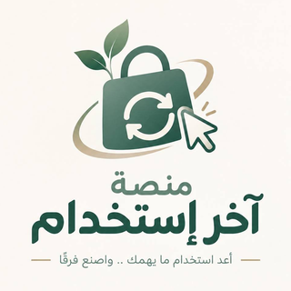
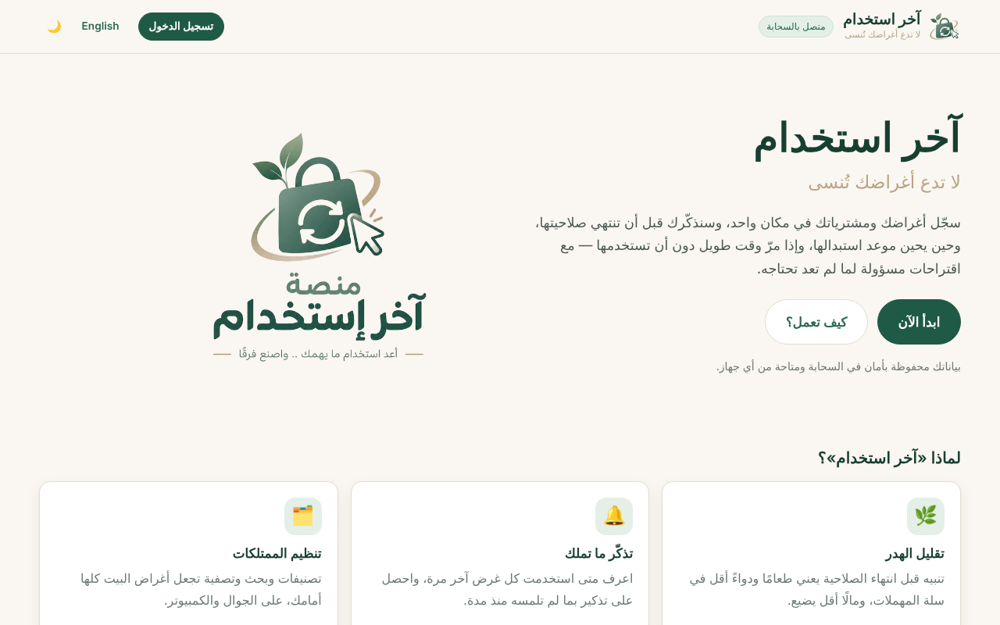
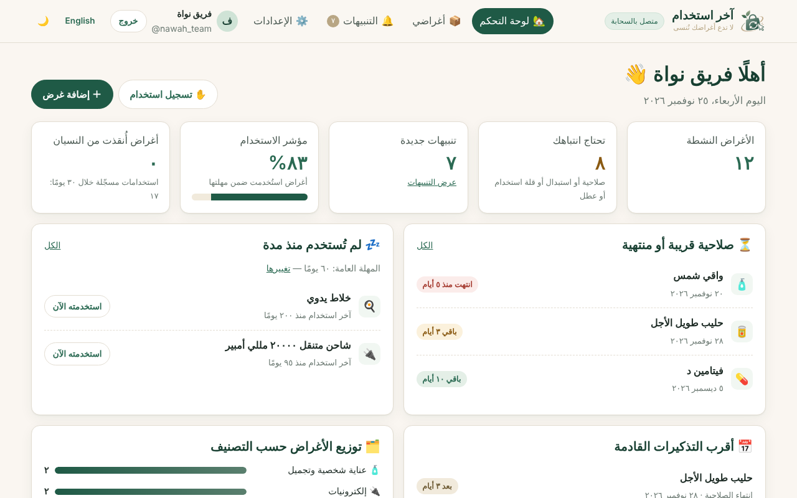
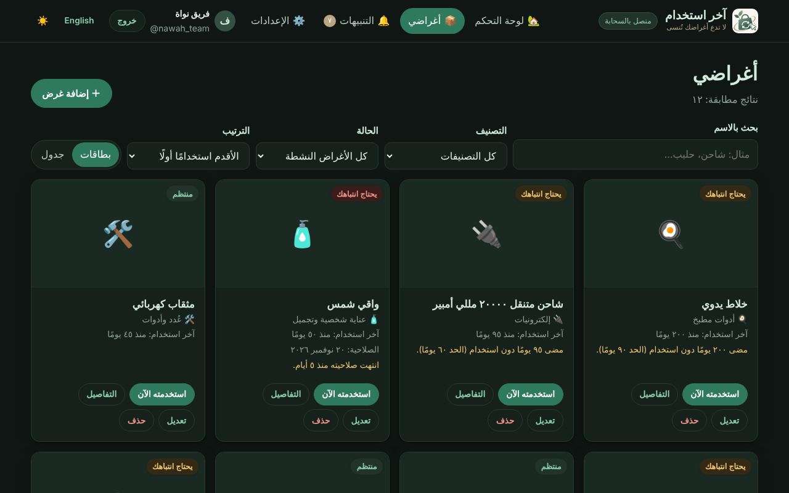

<div align="center">



# آخر استخدام

**لا تدع أغراضك تُنسى**

منصة ويب عربية تساعد الأفراد والأسر على تنظيم ممتلكاتهم، ومعرفة آخر مرة استُخدم فيها كل غرض، والتنبيه قبل انتهاء الصلاحية أو حلول موعد الاستبدال، مع اقتراحات مسؤولة لما لم يعد مستخدمًا.

</div>

---

## الفكرة

في كل بيت أغراض تُشترى ثم تُنسى: أدوية تنتهي صلاحيتها في الخزانة، وأجهزة لم تُستخدم منذ شهور، وفلاتر تجاوزت موعد استبدالها. «آخر استخدام» يجمع هذه الأغراض في مكان واحد، ويتابع تواريخها نيابةً عن المستخدم، ويذكّره في الوقت المناسب. وحين يبقى غرض بلا استخدام طويلًا، تقترح المنصة إعادة استخدامه أو إهداءه أو التبرع به، أو التخلص منه بطريقة مناسبة، فيقلّ الهدر ويستفيد المستخدم مما يملك.

## المزايا

- **سجل الأغراض:** الاسم والتصنيف والصورة، وتاريخ الشراء والصلاحية وآخر استخدام، وحالة الغرض.
- **تسجيل الاستخدام بنقرة:** زر «استخدمته الآن» يحدّث آخر استخدام ويحفظ سجلًا كاملًا.
- **تنبيهات ذكية:** لاقتراب انتهاء الصلاحية، والاستبدال الدوري، وقلة الاستخدام، ولا يتكرر أي تنبيه.
- **لوحة تحكم:** ملخص محسوب من البيانات الفعلية، وأقرب التذكيرات، وتوزيع الأغراض حسب التصنيف.
- **بحث وتصفية:** بحث عربي يتجاهل الهمزات والتشكيل، وتصفية حسب التصنيف والحالة، وترتيب متعدد.
- **اقتراحات الاستدامة:** أصلحه، أعد استخدامه، أهدِه، تبرّع به، أو تخلّص منه بطريقة مناسبة، مع سجل للأثر.
- **حساب فوري:** التسجيل باسم مستخدم وكلمة مرور فقط.
- **لغتان:** العربية والإنجليزية، مع اتجاه الصفحة المناسب لكل لغة.
- **الوضع الليلي:** فاتح أو داكن أو حسب إعداد الجهاز.
- **تصميم متجاوب** للجوال والكمبيوتر، مع مراعاة إمكانية الوصول.
- **حماية البيانات:** كل مستخدم يرى بياناته فقط عبر سياسات Row Level Security.

## صور من المنصة

<div align="center">



<sub>الصفحة الرئيسية</sub>

<br><br>



<sub>لوحة التحكم</sub>

<br><br>



<sub>صفحة الأغراض في الوضع الليلي</sub>

</div>

## التقنيات

| الطبقة | التقنية |
|---|---|
| الواجهة | HTML5 · CSS3 · JavaScript (ES Modules) |
| الخادم | Node.js · Express |
| قاعدة البيانات والمصادقة والتخزين | Supabase (PostgreSQL · Auth · Storage) |
| الاستضافة | Render · GitHub |

## هيكل المشروع

```
last-use/
├── public/        الواجهة: الصفحات والتنسيق والسكربتات
│   └── js/shared/ منطق مشترك بين الواجهة والخادم (التذكيرات، التحقق، الترجمة)
├── server/        الخادم وواجهات API
├── supabase/      مخطط قاعدة البيانات وسياسات الحماية
├── docs/          التوثيق والصور
└── tests/         الاختبارات
```

## التوثيق

- [مواصفات المنتج](docs/product-spec.md)
- [نموذج البيانات](docs/data-model.md)
- [التشغيل والنشر](docs/setup.md)

---

<div align="center">

© 2026 جميع الحقوق محفوظة لـ **فريق نواة** — الكلية التقنية بمحايل عسير

</div>
